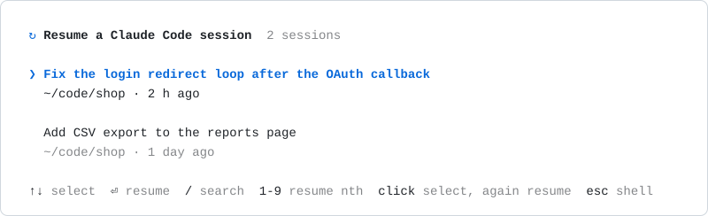

# rawr

Rex Agents: Wake and Resume.
Bring Claude Code agents back into their panes after a [Rex] server restart.

Rex restores sessions, tabs and panes after a restart, but each pane comes back as a fresh shell.
`rawr` remembers which Claude Code sessions ran in each pane, and in a restored pane offers them again in a full-screen picker.
Choosing one resumes it in that pane; dismissing the picker leaves a plain shell.



The picker opens on the alternate screen, so the pane's restored output is back unchanged when it closes.

| Action | Keys | Mouse |
| --- | --- | --- |
| Search every local session | Type; `Backspace`, `Ctrl+U` or `Esc` to clear | |
| Select | `↑` `↓`, `Home` `End`, `PgUp` `PgDn` | Click another session, or scroll the wheel |
| Resume | `Enter` | Click the selected session |
| Show all the pane's sessions, or fewer | `Ctrl+O` | |
| Leave a plain shell | `Esc` with nothing typed, `Ctrl+C` | |

The search box sits at the bottom, under the list, and takes every printable key, so there is no key to open it.
The list shows the newest `picker.rows` sessions (3 by default), then a dim `+N earlier · ctrl+o` row when more exist.
While you type, the list shows every match.

After you dismiss the picker, one dim line on stderr names the way back: `rawr pick` reopens this pane's sessions, and `rawr find` searches all.
`rawr pick` and `rawr find` read `picker.rows` from the config file `$XDG_CONFIG_HOME/rawr/config.yaml`, or `~/.config/rawr/config.yaml`.

Search matches every word typed, ignoring case, against the prompts typed in a session, its title, its folder and its ID.
It reads Claude Code's prompt history, `~/.claude/history.jsonl`, and lists `~/.claude/projects/` once to keep only sessions whose transcript is still there.
Each row's title is the one Claude Code shows, read from the end of the session's transcript; a session with none takes its first prompt that is not a slash command such as `/config`.

Hovering a session brightens it and shows the hand pointer in terminals that support OSC 22.
Each session shows its title, then its folder and how long ago it was active; long ones wrap, and nothing is cut.

## How it works

Rex keeps a pane's block ID across a server restart, so the block ID is the pane's identity.

| Command | Run by | Does |
| --- | --- | --- |
| `rawr record` | A Claude Code `SessionStart` hook | Adds the session to the pane's index, then deletes the indexes of panes the Rex server no longer lists |
| `rawr pick` | The shell, when it starts in a Rex pane | Offers the pane's sessions that no running Claude Code holds, and resumes the chosen one in its folder |
| `rawr find [WORDS…]` | You, from any shell | Opens the picker over every local session with the words typed, and resumes the chosen session as `pick` does |
| `rawr status [--format json]` | You, from any shell | Lists each Rex pane that has a session with its newest session's title and folder, and what its Claude is doing: Working, Needs input, Idle, Failed, or Stopped when no Claude runs there |
| `rawr setup claude [--dry-run]` | You, once | Adds the `SessionStart` hook that runs `rawr record` to Claude Code's user settings |
| `rawr completion bash\|zsh\|fish` | Your shell, at start | Prints the shell's completion script; Tab then completes from the installed binary |

## Shell integration

On a choice, `pick` and `find` restore the terminal and become `claude --resume` in the session's folder; when Claude Code exits, the pane's shell prompt is back.
They need no wrapper, so `rawr find` works as typed in any shell.
In zsh, offer a restored pane its sessions once, before the first prompt:

```zsh
if [[ -n $REX_BLOCK ]] && (( $+commands[rawr] )); then
  autoload -Uz add-zsh-hook
  _rawr_once() {
    add-zsh-hook -d precmd _rawr_once
    rawr pick
  }
  add-zsh-hook precmd _rawr_once
fi
```

`record` runs from a Claude Code `SessionStart` hook.
`rawr setup claude` adds it to `~/.claude/settings.json`, or to `$CLAUDE_CONFIG_DIR/settings.json`, and keeps every other setting in its order; `--dry-run` reports what it would do and changes nothing.
A second run reports the hook is there and changes nothing.
It edits the file only when you run it.
The hook it adds:

```json
{
  "hooks": {
    "SessionStart": [
      {
        "hooks": [
          { "type": "command", "command": "rawr record", "timeout": 10 }
        ]
      }
    ]
  }
}
```

Load completion at shell start: `source <(rawr completion zsh)` in `~/.zshrc` after `compinit`, `source <(rawr completion bash)` in `~/.bashrc`, or `rawr completion fish | source` in `~/.config/fish/config.fish`.

## License

MIT

[Rex]: https://www.superlogical.com/rex
